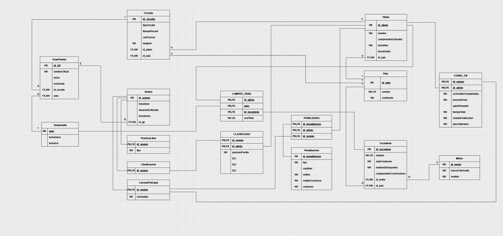

# Base de datos para la gestión de campeonatos de Fórmula 1

Diseño e implementación de una base de datos relacional (PostgreSQL) para administrar circuitos, escuderías, pilotos, Grandes Premios, sesiones y resultados de un campeonato de Fórmula 1, incluyendo las clasificaciones de pilotos y constructores.

> **Trabajo práctico** de la materia *Bases de Datos* (Ingeniería en Sistemas de Información, UTN FRSF, 2026).
> 

## Qué problema resuelve

Una organización internacional necesita registrar la información de los campeonatos y poder:

- Consultar la **clasificación parcial** en cualquier momento de la temporada (posición, puntos acumulados y diferencia con el líder), para pilotos y para escuderías.
- Determinar a los **campeones** al cierre de cada temporada.
- Mantener el **historial de escuderías** de cada piloto, temporada por temporada.
- Registrar **resultados de carrera, clasificación y penalizaciones**.

## Contenido del repositorio

```
.
├── README.md
├── docker-compose.yml            # PostgreSQL listo para usar
├── sql/
│   ├── 01_schema.sql             # Creación de tablas, restricciones e índices
│   └── 02_datos_ejemplo.sql      # Datos ficticios para probar el modelo
├── consultas/
│   └── consultas_ejemplo.sql     # Clasificaciones, resultados, historial, penalizaciones
└── docs/
    ├── diccionario-de-datos.md   # Descripción de tablas y columnas
    └── diagramas/
        ├── der.png               # Diagrama Entidad-Relación (modelo conceptual)
        └── diagrama-de-tablas.png# Diagrama de tablas (modelo lógico)
```

## Modelo de datos

### Modelo conceptual (DER)


Puntos destacados del diseño:

- **Especialización de `Sesion`** en `PracticaLibre`, `Clasificacion` y `CarreraPrincipal`, con los datos comunes en la superclase.
- **Relaciones con atributos** (`COMPITE_PARA`, `CLASIFICADO`, `CORRE_EN`, `PENALIZADO`) que resuelven las relaciones muchos a muchos entre pilotos, temporadas, escuderías y sesiones.
- **Historial de escuderías** a través de `COMPITE_PARA` (piloto + temporada + escudería).

### Modelo lógico (diagrama de tablas)



El detalle de cada tabla está en el [diccionario de datos](docs/diccionario-de-datos.md).

## Cómo ejecutarlo

### Opción 1: con Docker (recomendada)

Requiere Docker con Docker Compose.

```bash
docker compose up -d
```

La primera vez, PostgreSQL ejecuta automáticamente los scripts de `sql/` (esquema y datos de ejemplo). Para conectarte:

```bash
docker exec -it formula1_db psql -U formula1 -d formula1
```

Para borrar todo y empezar de cero:

```bash
docker compose down -v
```

### Opción 2: con un PostgreSQL propio (14 o superior)

```bash
createdb formula1
psql -d formula1 -f sql/01_schema.sql
psql -d formula1 -f sql/02_datos_ejemplo.sql
```

## Consultas de ejemplo

En [`consultas/consultas_ejemplo.sql`](consultas/consultas_ejemplo.sql) hay cinco consultas listas para ejecutar:

1. Clasificación parcial de **pilotos** (posición, puntos y diferencia con el líder).
2. Clasificación parcial de **constructores** (suma de los dos pilotos de cada escudería).
3. **Resultado de una carrera**, con la escudería con la que compitió cada piloto.
4. **Historial de escuderías** de cada piloto.
5. **Penalizaciones** por Gran Premio.

Ejemplo, desde `psql`:

```bash
docker exec -i formula1_db psql -U formula1 -d formula1 < consultas/consultas_ejemplo.sql
```

El campeón de la temporada es quien ocupa el primer puesto de las consultas 1 y 2 cuando la temporada finaliza.

## Decisiones de diseño

- **Tiempos con `INTERVAL`:** los tiempos de vuelta, de clasificación y de carrera se guardan como `INTERVAL` de PostgreSQL, que permite compararlos y operar con ellos (formato de carga `mm:ss.mmm`).
- **Escudería de un resultado:** `corre_en` no repite la escudería. Se obtiene a partir de `compite_para` según el piloto y la temporada del Gran Premio, evitando datos duplicados.
- **Integridad de las penalizaciones:** `penalizado` referencia con una clave foránea compuesta a `corre_en`, de modo que solo se puede sancionar a un piloto que corrió esa carrera.
- **Restricciones de dominio** con `CHECK`: tipos de circuito, tipos de práctica libre, tipos de penalización, estados de finalización, formato del código ISO, rangos de valores, etc.

## Ajustes respecto de la entrega original

Al implementar el modelo en SQL se hicieron estos cambios sobre los diagramas presentados:

| Tema | Entrega original | Implementación |
|---|---|---|
| Nombre del circuito | No figuraba en el diagrama de tablas | Se agrega `circuito.nombre` (lo pide el enunciado) |
| Clave de `compite_para` | (piloto, año, escudería) | (piloto, año): una escudería por piloto y temporada |
| Número de piloto | Único en toda la tabla | Único **por temporada** (`UNIQUE (anio, nro_piloto)`) |
| País | `id_pais` genérico | `id_pais` es el código ISO de 3 letras |
| Récord del circuito | Piloto obligatorio | Tiempo y piloto opcionales, pero ambos o ninguno |
| Tiempo total de carrera | Obligatorio | Opcional (quien abandona no tiene tiempo total) |
| Penalización | Clave de `penalizado` con 3 columnas | Clave = `id_penalizacion`, más FK compuesta a `corre_en` |

Los diagramas de `docs/diagramas/` corresponden a la entrega original; el script SQL es la versión de referencia.

## Limitaciones conocidas

- La **disjunción de la especialización** de `sesion` (que una sesión sea de un único tipo) no está forzada por el esquema; requeriría un trigger o una columna de tipo.
- No se valida con restricciones que cada escudería tenga **dos pilotos por temporada**, ni que la fecha de un Gran Premio caiga dentro de su temporada.
- Los **puntos** de cada carrera se cargan como dato; no se calculan según la posición.

## Notas

- Los datos de `02_datos_ejemplo.sql` son **ficticios** y solo sirven para probar el modelo.
- Este repositorio documenta un trabajo académico.
